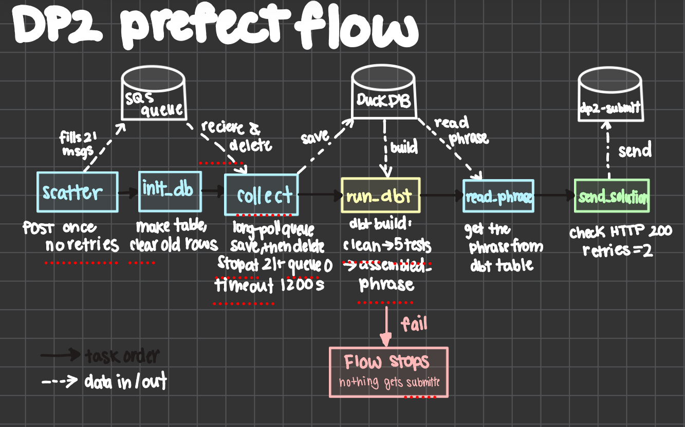
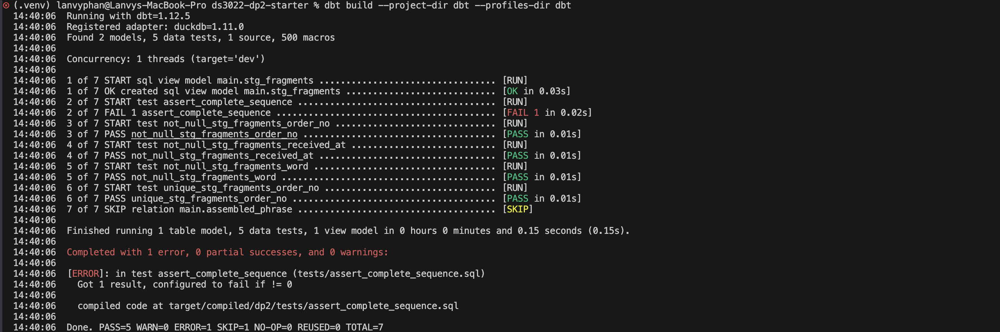
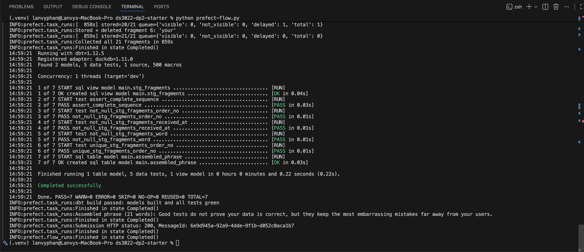
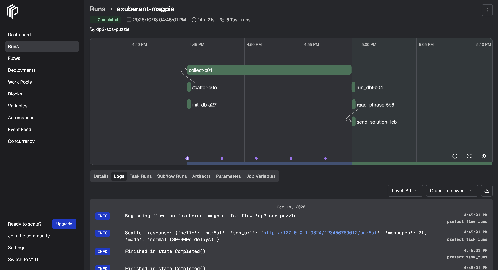

# DS 3022 Data Project 2: The SQS Puzzle

Lanvy Phan (`paz5at`) · Platform: Prefect · Receipt: `C21AD53E68`

This is my Prefect pipeline for the SQS puzzle. It scatters 21 word fragments onto a queue, waits for them to show up (they're delayed randomly), saves each one to DuckDB, uses dbt to check and put them back in order, and only submits the phrase if every dbt test passes.

```
POST /api/scatter/paz5at
        │
        ▼
SQS queue paz5at  (21 messages, 30-900 s delays)
        │
        ▼
Prefect flow (prefect-flow.py)
  scatter → init_db → collect (monitor → receive → land → delete)
        │
        ▼
dbt build:  stg_fragments → tests → assembled_phrase
        │   (if anything fails, the flow stops here)
        ▼
read_phrase → send_solution (dp2-submit) → kit/check_submission.py → receipt
```

My DAG sketch:



---

## How to run it

You need Python 3.12 or 3.13. [SETUP.md](SETUP.md) has all the details, but the short version is:

```bash
python3 -m venv .venv
source .venv/bin/activate
pip install -r requirements.txt
cp .env.example .env          # then set UVA_ID to your computing ID
```

You need four terminals open with the venv activated in each one. I started them in this order:

| Terminal | Command |
|---|---|
| T1 · Emulator | `moto_server -p 9324` |
| T2 · Scatter API | `python kit/scatter_api.py` |
| T4 · Prefect | `prefect server start` (dashboard at http://127.0.0.1:4200) |
| T3 · Work | `python kit/smoke_test.py` → should say `Emulator OK` |

Then run the pipeline and check it in T3:

```bash
python prefect-flow.py
python kit/check_submission.py
```

`DP2_FAST=1` in `.env` makes the delays 5-60 s, which is what I used while building it. `DP2_FAST=0` gives the real 30-900 s delays. You have to restart T2 after you change it. You can also change the collect timeout with `DP2_TIMEOUT` (it's 1200 s by default).

One problem I hit on my Mac: `pip install` failed with `CERTIFICATE_VERIFY_FAILED` on `dbt-core-experimental-parser`. Running `/Applications/Python 3.13/Install Certificates.command` once and then installing again fixed it.

---

## How the pipeline works

| Task | What it does | Why I did it this way |
|---|---|---|
| `scatter` | POSTs to the scatter API once and returns the queue URL | It has `retries=0` because every POST wipes the queue and refills it, so if it retried halfway through a run I'd lose my progress. It only ever runs once per flow run. |
| `init_db` | Makes `raw.fragments` if it doesn't exist and clears out old rows | Each run re-sends all 21 messages, so old rows aren't useful anymore. |
| `collect` | Watches the queue, receives messages, saves them, deletes them | Explained in the next section. |
| `run_dbt` | Runs `dbt build` through `dbtRunner` | dbt is the quality check. If it fails, this task raises an error and the flow stops before submitting anything. |
| `read_phrase` | Reads the phrase from `assembled_phrase` | dbt builds the phrase, and Python just reads it. |
| `send_solution` | Sends the phrase to `dp2-submit` and checks that it got HTTP 200 | It raises an error if the status isn't 200. I gave it `retries=2` because submitting the same answer twice doesn't hurt anything (unlike scatter). |

My computing ID, the endpoint, and the database path all come from `.env`, so nothing is hard-coded.

---

## My polling strategy

Every time through the loop in `collect`, the pipeline:

1. **Checks the queue counters** with `get_queue_attributes`: visible, not visible (in flight), and delayed. It logs all three plus the total, so you can watch the queue go down in the Prefect logs.
2. **Checks if it's done.** It only stops when I've stored 21 different `order_no`s **and** all three counters are 0. I trust my own count more because the counters are only "approximate." Checking that the queue is empty too means I don't leave a duplicate message sitting there.
3. **Checks the timeout.** If more than 1200 s have passed (900 s max delay plus some extra), it raises an error like `Gave up after 1200s with 17/21 fragments`. That way the run fails clearly instead of hanging forever.
4. **Long polls** with `receive_message(MaxNumberOfMessages=10, WaitTimeSeconds=10, MessageAttributeNames=["All"])`.
5. **Saves first, then deletes.** Each fragment goes into `raw.fragments` (`order_no`, `word`, `received_at`, `message_id`) **before** I delete its message. If something crashed in between, the worst case is a duplicate row, which dbt removes anyway. I can't lose a fragment this way.

**Why long polling?** The messages show up at random times over about 15 minutes, so the pipeline spends most of its time waiting. If I polled in a fast loop I'd make thousands of calls that come back empty. If I slept for a long time between polls I'd finish way after the last message was ready. With `WaitTimeSeconds=10`, each call waits on the server side and comes back **as soon as** a message is visible. That means it picks up a message almost as soon as it's ready, but when nothing's there it only makes about 6 receive calls a minute (plus one counter check each loop). Capping it at 10 s also means the counters get logged and the timeout gets checked at least every 10 seconds.

When nothing is visible, the response doesn't have a `Messages` key at all, so I use `resp.get("Messages", [])` so it doesn't crash.

**Duplicates and malformed messages.** Before saving, each message goes through `parse_fragment`, which checks that it has an `order_no` from 1 to 21 and a non-empty `word`. If a message fails the check, it gets saved to a separate `raw.rejected` table with the reason, logged as a warning, and **still deleted**, so it never sits on the queue or reaches dbt. Duplicates are saved and deleted too, but they only count once toward the 21, and `stg_fragments` keeps just one copy.

---

## How my dbt tests protect the result

| File | What it does |
|---|---|
| `models/staging/stg_fragments.sql` | Casts `order_no` to an integer (otherwise `10` sorts before `2`), trims `word` and turns empty strings into `NULL`, and keeps one row per `order_no` using `row_number()` (the first one received). That way a fragment getting saved twice doesn't break anything. |
| `models/staging/schema.yml` | Generic tests: `not_null` and `unique` on `order_no`, and `not_null` on `word` and `received_at`. |
| `tests/assert_complete_sequence.sql` | My singular test. It fails unless there are exactly 21 rows, 21 distinct order numbers, the min is 1 and the max is 21. All of that together means the numbers go 1 to 21 with no gaps. |
| `models/marts/assembled_phrase.sql` | One row with the phrase: `string_agg(word, ' ' ORDER BY order_no)`. |

Since `assembled_phrase` depends on `stg_fragments`, dbt **skips** it if any test before it fails. Then `run_dbt` raises an error, so a missing, duplicate, or blank fragment can never get submitted.

**Making a test fail on purpose.** I deleted fragment 7 from `raw.fragments` and ran `dbt build`. `assert_complete_sequence` failed and `assembled_phrase` got skipped:



**Then passing again.** I re-ran the full pipeline, which put the data back, and all 7 passed:



---

## Full-delay run (DP2_FAST=0)



With the real 30-900 s delays, it collected all 21 fragments in **859 s** (about 14 minutes), dbt passed 7/7, and the submission returned HTTP 200.

---

## What each tool does

| Tool | Its job in my pipeline | What I'd lose without it |
|---|---|---|
| **Prefect** | Runs the tasks in order, logs everything, and shows each run in the dashboard. It's also where `retries=0` on scatter and the dbt gate (stop the flow if dbt fails) live. | I'd just have a plain Python script with print statements. No dashboard, no run history, no per-task retries, and it'd be way harder to see where a 15-minute run got stuck. |
| **DuckDB** | Stores every fragment the moment it arrives (`raw.fragments`, plus `raw.rejected` for bad messages). It's a single file, so there's no server to run. | If the fragments only lived in Python memory, a crash halfway through would lose everything I'd already deleted from the queue. DuckDB is what makes "save, then delete" actually safe. |
| **dbt** | Cleans and dedupes the data, runs the tests, and builds the phrase in SQL. | Without dbt, the checks would be ad hoc Python. I wouldn't have reusable tests, and nothing would formally stop a bad phrase from being submitted. |

## Result

> Good tests do not prove your data is correct, but they keep the most embarrassing mistakes far away from your users.

```
PASS  paz5at / prefect  receipt: C21AD53E68
```

**Receipt code: `C21AD53E68`**

---

## Chaos round

_Filling this in during Lesson 11._

- What got injected:
- What happened to my pipeline:
- What I changed (if anything):